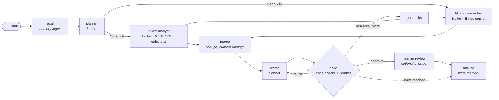

# Equity Research Agents

**A multi-agent research team that answers analyst questions about public companies with a cited memo, where every number is traced to SEC data and checked before it ships.**

> *"How did NVIDIA's revenue change in fiscal 2025, and what does management say drove it?"*
>
> → a planner splits the question; a quant analyst pulls revenue from SEC XBRL and computes growth with a calculator tool; a filings researcher searches the 10-K for management's explanation; a writer drafts the memo; a critic verifies every figure and citation, sends it back if anything is off, and the team remembers what it learned.

Built on **LangGraph** and **Claude**. It reuses [filings-copilot](https://github.com/KevinBenass/filings-copilot) (hybrid search + reranking over 10-Ks) as a tool, so the two projects form one system.

[](https://github.com/KevinBenass/equity-research-agents/actions/workflows/ci.yml)

## Architecture



| Concern | How it is handled | Where |
|---|---|---|
| **Orchestration** | LangGraph state machine; parallel fan-out with `Send`, fan-in through an additive reducer; bounded revise and research loops; SQLite checkpointing with `interrupt` for human approval and resume | [`graph.py`](src/equity_agents/graph.py), [`runner.py`](src/equity_agents/runner.py) |
| **Structured handoffs** | Agents exchange typed `Task`, `Finding` and `Review` objects, never transcripts. The planner, the critic and each worker's final report use **structured outputs** (JSON constrained to a schema by the API), so a handoff can't be malformed. The writer may only use findings; every finding carries a source ref | [`state.py`](src/equity_agents/state.py) |
| **Context engineering** | Each worker sees only its self-contained brief plus memory facts for its own tickers; tool outputs truncated at the source; per-worker token budget with **observation masking** (old tool results compacted to previews); prompt caching on system prompts and tool definitions | [`agents/worker.py`](src/equity_agents/agents/worker.py), [`llm.py`](src/equity_agents/llm.py) |
| **Grounding** | Numbers come from SEC XBRL via SQL, arithmetic from a sandboxed calculator. After each worker reports, code checks that every cited passage was actually returned by a search, re-reads XBRL values from the database and re-evaluates calculations; failures are downgraded and flagged | [`tools/`](src/equity_agents/tools), `verify()` in [`worker.py`](src/equity_agents/agents/worker.py) |
| **Review** | The critic runs **deterministic checks first** (every number in the memo must match a verified finding at its displayed precision; every numeric sentence must cite; no unknown citations), then an LLM review for judgment calls (overstated claims, missing evidence → new research tasks). Code failures always block approval | [`numbers.py`](src/equity_agents/numbers.py), `review_memo()` |
| **Memory** | **Semantic**: verified facts with provenance, versioned on conflict. **Episodic**: past questions and summaries, retrieved by similarity. **Procedural**: lessons distilled from critic reviews, injected into the writer's prompt | [`memory/store.py`](src/equity_agents/memory/store.py) |
| **Model routing** | Sonnet where judgment matters (planning, writing, reviewing), Haiku for tool loops | [`configs/default.yaml`](configs/default.yaml) |
| **Observability** | Every LLM and tool call is a span (agent, model, tokens, cost, latency, errors) in `runs/<id>/trace.jsonl`; `era trace <id>` renders the tree and per-agent cost | [`tracing.py`](src/equity_agents/tracing.py) |

## Evaluation

Agent demos are easy; knowing whether the team is right, grounded and worth its cost is the hard part. `era eval` measures all three.

- **Ground truth from data, not opinion.** Questions are generated from XBRL (growth, margins, cross-company comparisons, "what changed and why"), so the correct numbers are computed, not written by hand or by an LLM.
- **Answer quality**: share of ground-truth numbers present in the memo (at displayed precision), unsupported numbers, citation coverage.
- **Trajectory**: did the plan involve the specialists the question needs; tool calls, errors, revisions, research rounds.
- **Critic fault injection**: approved memos are corrupted on purpose (a figure off by 7%, an invented figure, a dropped citation, a citation to a non-existent finding, a swapped company name) and fed back to the critic. A reviewer that approves everything looks perfect on clean drafts; this measures whether it actually catches errors.
- **Memory ablation**: the same questions run with empty memory, then again with the memory from the first pass. Reports the change in tool calls, cost and latency.
- **Cost and latency** per question, broken down by agent.

### Results

<!-- RESULTS:START -->
#### Answer quality and cost by question type

| template   | n   | numeric_recall   | all_correct   | unsupported_numbers   | citation_coverage   | specialists_ok   | approved   | revisions   | tool_calls   | cost_usd   | latency_s   |
|:-----------|:----|:-----------------|:--------------|:----------------------|:--------------------|:-----------------|:-----------|:------------|:-------------|:-----------|:------------|
| comparison | 6   | 1.00             | 1.00          | 0.00                  | 1.00                | 1.00             | 1.00       | 1.00        | 12.50        | $0.274     | 81.58       |
| drivers    | 6   | 0.83             | 0.83          | 1.50                  | 0.72                | 1.00             | 0.33       | 1.67        | 11.17        | $0.402     | 134.87      |
| growth     | 6   | 1.00             | 1.00          | 0.33                  | 0.61                | 1.00             | 0.83       | 0.67        | 7.33         | $0.114     | 45.97       |
| margin     | 6   | 1.00             | 1.00          | 0.00                  | 1.00                | 1.00             | 1.00       | 0.83        | 3.33         | $0.059     | 26.67       |
| **all**    | 24  | 0.96             | 0.96          | 0.46                  | 0.83                | 1.00             | 0.79       | 1.04        | 8.58         | $0.212     | 72.27       |

#### Critic fault injection: share of corrupted memos rejected

| mutation         | n   | caught by code checks   | caught by code + LLM review   |
|:-----------------|:----|:------------------------|:------------------------------|
| drop_citation    | 19  | 1.00                    | 1.00                          |
| fabricate_number | 19  | 1.00                    | 1.00                          |
| perturb_number   | 18  | 0.94                    | 1.00                          |
| swap_company     | 19  | 0.00                    | 1.00                          |
| unknown_citation | 19  | 1.00                    | 1.00                          |

#### Memory: same questions, cold vs. warm memory

| memory                | tool_calls   | llm_calls   | cost_usd   | latency_s   | numeric_recall   |
|:----------------------|:-------------|:------------|:-----------|:------------|:-----------------|
| cold (empty memory)   | 4.83         | 9.33        | $0.094     | 39.97       | 1.00             |
| warm (after one pass) | 4.00         | 8.67        | $0.065     | 30.80       | 1.00             |

<!-- RESULTS:END -->

## Quickstart

```bash
make setup                    # install; copy .env.example to .env and add ANTHROPIC_API_KEY, SEC_USER_AGENT
make data                     # download SEC XBRL company facts for the 8 covered companies (free)

# In the filings-copilot repo, start the filings search service (port 8000):
#   make api
# Then:
uv run era ask "How did NVIDIA's revenue change in fiscal 2025, and what does management say drove it?"
uv run era ask "Compare Microsoft's and Alphabet's operating margins in fiscal 2024" --review   # pause for approval
uv run era resume <run_id> --approve
uv run era trace <run_id>     # span tree with per-agent tokens and cost
uv run era memory             # what the team has learned
make smoke                    # one question per type on the real API (~$0.50); stops at the first error
make eval                     # full evaluation (~$5-10 in API usage)
```

Without filings-copilot running, quantitative questions still work; the filings researcher reports that search is unavailable and the critic flags the missing evidence.

## Tests

`make test` also checks every request against the API's rules (structured-output schema limits, no forced tool calls, alternating roles, tool definitions present when the history has tool calls, parameters accepted by the installed SDK), so a paid run doesn't fail on a malformed request. It runs the real graph, tool loop, grounding checks, critic routing, memory and human-in-the-loop resume against a **scripted Claude backend** and an XBRL fixture in SEC's format. No network, no API key; CI runs it on every push.

## Repository layout

```
src/equity_agents/
  graph.py          LangGraph wiring, routing, critic (review_memo)
  agents/           prompts.py · worker.py (tool loop, compaction, grounding checks)
  tools/            xbrl.py (SEC facts -> DuckDB) · filings.py (filings-copilot client) · calc.py · base.py
  memory/store.py   semantic, episodic and procedural memory (SQLite)
  numbers.py        number extraction and precision-aware matching
  llm.py            Claude client: caching, cost, compaction helpers
  tracing.py        spans -> runs/<id>/trace.jsonl
  runner.py         run, persist, resume
  evals/            dataset.py · metrics.py · fault_injection.py · run.py
  cli.py            `era`
```

## Design notes

- **Why not one agent with all the tools?** Parallel specialists keep each context small and focused, cut latency on multi-part questions, and let cheap models run the tool loops. The cost is coordination, which the typed handoffs and the critic pay for.
- **Why deterministic checks before the LLM critic?** "Is this number in the evidence?" has an exact answer; asking a model is slower, costlier and occasionally wrong. The LLM reviews only what code cannot decide.
- **Why remember facts only from approved runs?** Memory that absorbs unverified numbers compounds errors across runs. Facts are versioned so a correction supersedes rather than silently overwrites.

## License

MIT
